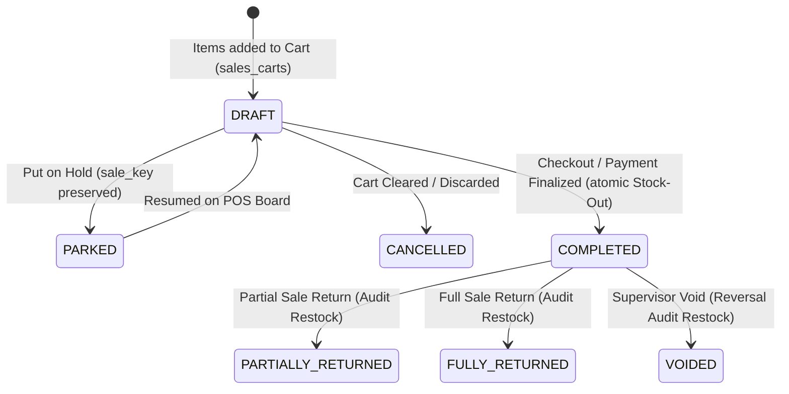

# POS & Inventory Engineering Guide & Architectural Rulebook
**Project:** Specialized Retail Point of Sale (POS) & Inventory System (Pakistani Market Edition)  
**Codebase:** `awan_buckle` (Laravel POS Engine)  
**Version:** 1.0.0 — Production Reference Architecture  
**Target Audience:** Software Architects, Core Engineers, and AI Code Assistants (Antigravity IDE / Gemini)

---

## Executive Summary & Architectural Overview

This guide serves as the definitive engineering manual for the `awan_buckle` retail POS and inventory management system. Built for high-throughput retail operations in Pakistan, the application purposefully departs from complex enterprise ERP conventions by enforcing two strict UX simplifications:
1. **Zero Categories in UI:** End-users are never prompted for categories or taxonomies. A single default category placeholder is quietly maintained under the hood to preserve relational integrity.
2. **Zero Variants in UI:** End-users are never exposed to complex SKU/size/color variant matrices. Every product is treated as a flat item with a single default unit and attribute configuration.

### The Problem This Guide Solves
Audit of the legacy codebase revealed severe discrepancies between reported stock levels and physical inventory on shelves. These errors stemmed from:
- Reliance on an unconstrained snapshot table (`product_available`) mutated directly across multiple disparate controllers without centralized concurrency controls.
- Asynchronous and non-transactional database writes creating race conditions during concurrent checkouts.
- Destructive mutation of historical invoice rows (`sale_order_items.qty`) during product returns, destroying invoice immutability and corrupting reporting.
- A critical mathematical inversion bug where negative stock initialization flipped subtractions into positive inventory gains.
- Complete omission of cross-shop transfers, purchase returns, and inventory adjustments from reporting calculations.

This guide lays out the immutable business rules, transactional mechanics, mathematical ledger specifications, and AI skills needed to prevent regressions and guide all future system development.

---

# Section 1: Core Business Logic & Constraints (The Deterministic Rules)

## 1.1 The "Zero Category & Flat Product" Directive

### Rule Definition
Under no circumstances should any user interface (modal, form, table filter, or wizard) present category pickers, category dropdowns, subcategory cascading selects, or variant attribute builders (e.g., Color, Size, Finish).

### Architectural Implementation:
- **Database Schema Reality:** The `products` table maintains a nullable `product_cat_id` foreign key for legacy schema compatibility with PITB IMS.
- **Silent System Injection:** During product creation (`Product::create`), if `product_cat_id` is null or omitted, the system MUST silently assign the default system category (`DEFAULT_CATEGORY_ID = 1`, labeled `"General Goods"` or `"Default"`).
- **Variant Elimination:** The legacy `product_attributes` pivot table must not receive dynamic inputs. Products have exactly one primary unit of measure (`uom_id`, defaulting to standard piece/unit `Uom::first()->id`) and a flat sale price (`price`) and cost price (`cost_price`).
- **Code Generation Prohibition:** Any AI assistant generating code for this repository MUST reject adding:
  - `<select name="parent_category_id">` or `<select name="sub_category_id">`
  - Dynamic variant generator grids
  - SKU attribute matrix generators

```
[UI Level]                          [Controller / Service Level]                [Database Level]
Product Name: "Gents Buckle #4"     --> Injects:                                --> products table:
Sale Price:   PKR 450                   product_cat_id = 1 (System Default)         id: 104
UOM:          Piece (Default)           uom_id         = 1 (Default Piece)          name: "Gents Buckle #4"
                                                                                    product_cat_id: 1
                                                                                    price: 450.00
```

---

## 1.2 Strict State Machine for Invoices & Orders

Legacy code lacked a formal state machine: orders were inserted as `status = 1` immediately, without transaction safeguards or status lifecycle tracking. The system now enforces a deterministic 5-stage lifecycle for all POS transactions.

### State Transition Diagram



### State Machine Rules:
1. **DRAFT / PARKED (`sales_carts`):**
   - Items resting in an active POS cart or parked on hold (`SaleBoardController::onHoldModalView`) **DO NOT** decrement physical stock.
   - Carts are non-locking staging records.
   - Validation occurs at the moment of checkout. If another till sells the last available units before checkout, checkout MUST fail with a clean validation error (`"Insufficient stock for [Product Name]"`), preventing negative or phantom stock.

2. **COMPLETED (`sale_orders.status = 'completed'` / integer code `1`):**
   - Triggered exclusively by `finalPlaceOrder`.
   - Requires payment capture (`cash_received >= total_price` or authorized ledger credit for registered customers).
   - **MUST** execute within an isolated database transaction (`DB::transaction`).
   - Simultaneously writes `sale_orders`, writes immutable `sale_order_items`, logs `StockAudit` (Action: `MINUS`), and decrements `product_available.qty`.
   - Deletes staging records from `sales_carts`.

3. **SALE RETURNS (`sales_return` & `sales_return_items`):**
   - **NEVER MUTATE ORIGINAL INVOICES:** Legacy `SaleOrderController::saleReturnSave` erroneously executed `$saleOrder->qty = $saleOrder->qty - $returnQty;` on the original `sale_order_items` record. **THIS IS STRICTLY FORBIDDEN.**
   - Original `sale_orders` and `sale_order_items` are historically immutable receipts.
   - A return creates an independent `sales_return` header and `sales_return_items` records.
   - Restocking occurs by logging a new `StockAudit` record (Action: `ADD`, Object: `SaleReturn`) targeting the shop where the items are **physically received**.

4. **VOIDED / SUPERVISOR CANCELLED:**
   - Voiding a completed order requires an explicit compensating transaction.
   - The original order status changes to `VOIDED`.
   - A compensating `StockAudit` entry (Action: `ADD`, Object: `OrderVoid`) is logged for every line item, safely restoring stock.

---

## 1.3 Strict Laws of Inventory Math

All developers and AI assistants must uphold four fundamental invariants:

### Law 1: The Principle of Conservation of Inventory
Inventory cannot appear or disappear. Every single modification to stock levels must be accompanied by a persistent, audit-traceable transaction record in `stock_audits`. Direct SQL queries or Eloquent calls such as `ProductAvailable::where(...)->decrement(...)` or `DB::table('product_available')->update(...)` without a corresponding `StockAudit` entry are considered **critical bugs**.

### Law 2: Prohibition of Negative Stock
Unless a shop explicitly has `allow_negative_inventory = true` in configuration, no transaction may decrement `product_available.qty` below zero. If `Requested Qty > Available Qty`, the operation MUST abort immediately with a 422 Unprocessable Entity HTTP response.

### Law 3: Atomic Concurrency & Pessimistic Locking
Because physical retail shops experience concurrent checkouts across multiple terminals, checking availability and decrementing stock MUST use pessimistic database locking (`SELECT ... FOR UPDATE` via Laravel's `lockForUpdate()`). 
Unprotected reads (`$pro = ProductAvailable::where(...)->first()`) followed by calculated saves (`$pro->qty = $new; $pro->save();`) cause catastrophic lost updates.

### Law 4: Dual-Store Reconciliation
`product_available` is strictly a **read-optimized denormalized cache table**. The **source of truth** is the historical event ledger (`stock_audits`). At any point in time, running an audit recalculation over the transaction ledger MUST equal the figure stored in `product_available.qty`. If it does not, a data desynchronization has occurred.

---

# Section 2: Inventory Architecture & Math Specification

## 2.1 The Ledger vs. Snapshot Architecture

```
+-----------------------------------------------------------------------------------+
|                           THE AUTHORITATIVE LEDGER                                |
|                                                                                   |
|  [Stock Inbound Events]                              [Stock Outbound Events]      |
|  - Purchases (StockDeliveryProduct)                  - POS Sales (SaleOrderItem)   |
|  - Sale Returns (SaleReturnItem)                     - Purchase Returns (PRItem)  |
|  - Transfer Receipts (StockExchange In)              - Transfer Dispatch (Ex Out) |
|  - Adjustments (+) (StockAdjustment In)              - Adjustments (-) (Adj Out)  |
|                                                                                   |
|                                        |                                          |
|                                        v                                          |
|                         [stock_audits Table (Ledger)]                             |
|                           Recorded Atomically with DB Locks                       |
+----------------------------------------+------------------------------------------+
                                         |
                                         | Synchronized Atomically
                                         v
+-----------------------------------------------------------------------------------+
|                        FAST-READ SNAPSHOT (Cache Table)                           |
|                                                                                   |
|                           product_available Table                                 |
|                           Unique: (product_id, shop_id)                           |
|                      Read by POS Board & Fast Shelf Checks                         |
+-----------------------------------------------------------------------------------+
```

---

## 2.2 Mathematical Ledger Specification

The real-world current stock $S_{\text{current}}$ for Product $P$ at Shop $K$ across all time is defined by the following audit-proof formula:

$$S_{\text{current}}(P, K) = \sum \text{StockIn}(P, K) - \sum \text{StockOut}(P, K)$$

Where:

$$\sum \text{StockIn}(P, K) = P_{\text{receipts}} + R_{\text{sale}} + R_{\text{walkin}} + T_{\text{in}} + A_{\text{positive}}$$

$$\sum \text{StockOut}(P, K) = S_{\text{pos}} + R_{\text{purchase}} + T_{\text{out}} + A_{\text{negative}} + V_{\text{void}}$$

### Event Classification Matrix

| Event Type | Model Source | Action Flag | Ledger Object Type | Quantity Sign | Affects Cost Price? |
| :--- | :--- | :--- | :--- | :--- | :--- |
| **Purchase Receipt** | `StockDeliveryProduct` | `cart.stock_action.add` | `StockPurchase` | **+ (In)** | Yes (Updates `cost_price`) |
| **POS Sale** | `SaleOrderItem` | `cart.stock_action.minus` | `Sale` | **- (Out)** | No |
| **Sale Return (Invoice-backed)** | `SaleReturnItem` | `cart.stock_action.add` | `SaleReturn` | **+ (In)** | No |
| **Sale Return (Unknown/Walk-in)**| `SaleReturnItem` | `cart.stock_action.add` | `SaleReturnUnknown`| **+ (In)** | No |
| **Purchase Return to Vendor** | `PurchaseReturnItem` | `cart.stock_action.minus` | `StockPurchaseReturn`| **- (Out)**| No |
| **Inter-Shop Transfer Out** | `StockExchange` | `cart.stock_action.minus` | `StockExchangeOut` | **- (Out)**| No |
| **Inter-Shop Transfer In** | `StockExchange` | `cart.stock_action.add` | `StockExchangeIn` | **+ (In)** | No |
| **Stock Adjustment (+)** | `StockAdjustment` | `cart.stock_action.add` | `StockAdjustment` | **+ (In)** | No |
| **Stock Adjustment (-)** | `StockAdjustment` | `cart.stock_action.minus` | `StockAdjustment` | **- (Out)**| No |
| **Supervisor Sale Void** | `SaleOrder` (Void) | `cart.stock_action.add` | `SaleVoid` | **+ (In)** | No |

---

## 2.3 Comprehensive Root-Cause Analysis of Current Bugs

Our deep dive identified the exact root causes of stock desynchronization across the codebase:

### 1. The Sign Inversion on Initialization Bug
* **File:** `app/Models/ProductAvailable.php` (Lines 44–57)
* **The Flaw:** When `manageStockByShopAndProductId` is called with `$action = StockAudit::STOCK_ACTION_MINUS` for a product that does not yet have a row in `product_available`, line 52 executes:
  ```php
  $newStock = ProductAvailable::create([
      'qty' => $chageQuantity, // BUG: Always positive!
      'product_id' => $productId,
      'shop_id' => $shopId 
  ]);
  ```
  If a cashier sold 5 units of an uninitialized SKU, the system recorded **+5** instead of **-5** (or throwing an error). A net swing of 10 units!

### 2. Missing Concurrency Locks & Race Conditions
* **Files:** `app/Models/ProductAvailable.php` (Line 32), `SaleCartController.php` (Line 483)
* **The Flaw:** `ProductAvailable::where(['shop_id' => $shopId, 'product_id' => $productId])->first()` executes a standard unshared read without `lockForUpdate()`. When two cashiers ring up the same buckle simultaneously, both read stock as `5`, subtract `2` and `3`, and write back conflicting numbers, losing inventory ledger accuracy.

### 3. Destruction of Historical Sale Invoices during Returns
* **File:** `app/Http/Controllers/Sale/SaleOrderController.php` (Lines 172–174)
* **The Flaw:** In `saleReturnSave`:
  ```php
  $saleOrder = SaleOrderItem::find($item);
  $saleOrder->qty = $saleOrder->qty - $returnQty; // BUG: Mutates historical receipt!
  $saleOrder->save();
  ```
  This alters the historical receipt line item. When `ProductStockController.php` sums `SaleOrderItem.qty` to compute total sales, the total sales figure is already reduced. Adding the `SaleReturn` record in the report effectively counts the return **twice**.

### 4. Cross-Branch Return Stock Misplacement
* **File:** `app/Http/Controllers/Sale/SaleOrderController.php` (Lines 153–183)
* **The Flaw:** 
  ```php
  $shopID = $order->shop_id; // Original issuing shop
  $loginShopID = auth()->user()->shop_id; // Current physical shop accepting return
  ...
  ProductAvailable::manageStockByShopAndProductId(..., $shopID, ...); // Restocks original shop!
  ```
  When a customer buys at Shop A and returns at Shop B, Shop A's inventory is falsely incremented, while Shop B's physical stock is left unrecorded on system!

### 5. Catastrophic Reporting Bugs in `ProductStockController.php`
* **File:** `app/Http/Controllers/Report/ProductStockController.php` (Lines 83–88)
* **The Flaw:**
  ```php
  $shops->map(function($shop, $val) use ($productId, $dates){
      $shop->available_qty = ProductAvailable::where('product_id', $productId)->where('shop_id', $shop->id)->sum('qty');
      $shop->sale_count = SaleOrderItem::where('product_id', $productId)->where($dates)->sum('qty'); // BUG: NO SHOP FILTER!
      $shop->purchase_count = StockDeliveryProduct::where('product_id', $productId)->where($dates)->sum('quantity'); // BUG: NO SHOP FILTER!
  });
  ```
  The report iterated over every shop and stamped the **global company-wide sales and purchases** into each shop's row! A shop with zero sales was reported as having sold the entire company's inventory.

### 6. Missing Database Transactions
* **File:** `app/Http/Controllers/Sale/SaleOrderController.php` (`saleReturnSave`)
* **The Flaw:** Unlike `finalPlaceOrder` or `unknowSaleReturnSave`, `saleReturnSave` contains no `DB::beginTransaction()` or `DB::commit()`. If an exception occurs halfway through returning 5 items, the loop aborts, leaving orphan return items and half-updated stock levels.

---

## 2.4 Reference Implementation: The Unified Inventory Service

To permanently eliminate duplicate, ad-hoc, and buggy stock calculations, all stock mutations must pass through a single, hardened service class: `App\Services\InventoryService`.

### Production-Grade Implementation Blueprint

```php
<?php

namespace App\Services;

use App\Models\Product;
use App\Models\ProductAvailable;
use App\Models\StockAudit;
use Exception;
use Illuminate\Support\Facades\DB;
use Illuminate\Support\Facades\Log;

class InventoryService
{
    /**
     * Atomically mutate stock and record an immutable ledger entry.
     *
     * @param int $productId
     * @param int $shopId
     * @param int $quantity Absolute positive quantity to adjust
     * @param string $action StockAudit::STOCK_ACTION_ADD or StockAudit::STOCK_ACTION_MINUS
     * @param string $objectType e.g., 'Sale', 'StockPurchase', 'SaleReturn', 'StockAdjustment'
     * @param int|null $objectId Primary key of the originating event
     * @param string|null $description Audit notes
     * @param bool $allowNegative Override negative stock protection
     * @return ProductAvailable
     * @throws Exception
     */
    public static function mutateStock(
        int $productId,
        int $shopId,
        int $quantity,
        string $action,
        string $objectType,
        ?int $objectId = null,
        ?string $description = null,
        bool $allowNegative = false
    ): ProductAvailable {
        if ($quantity <= 0) {
            throw new Exception("Stock mutation quantity must be strictly greater than zero. Received: {$quantity}");
        }

        if (!in_array($action, [StockAudit::STOCK_ACTION_ADD, StockAudit::STOCK_ACTION_MINUS], true)) {
            throw new Exception("Invalid stock action: {$action}");
        }

        // Must run inside transaction
        if (DB::transactionLevel() === 0) {
            throw new Exception("Inventory mutations must execute inside an active database transaction.");
        }

        // 1. Acquire pessimistic row lock
        $stockRecord = ProductAvailable::where('shop_id', $shopId)
            ->where('product_id', $productId)
            ->lockForUpdate()
            ->first();

        $oldQty = $stockRecord ? (int)$stockRecord->qty : 0;
        $delta = ($action === StockAudit::STOCK_ACTION_ADD) ? $quantity : -$quantity;
        $newQty = $oldQty + $delta;

        // 2. Enforce Non-Negative Inventory Invariant
        if ($newQty < 0 && !$allowNegative) {
            $product = Product::find($productId);
            $productName = $product ? $product->name : "ID #{$productId}";
            throw new Exception("Insufficient stock for '{$productName}'. Available: {$oldQty}, Requested: {$quantity}");
        }

        // 3. Update or Insert Snapshot Table
        if ($stockRecord) {
            $stockRecord->qty = $newQty;
            $stockRecord->save();
        } else {
            $stockRecord = ProductAvailable::create([
                'shop_id'    => $shopId,
                'product_id' => $productId,
                'qty'        => $newQty,
            ]);
        }

        // 4. Record Immutable Ledger Entry
        StockAudit::create([
            'product_id'      => $productId,
            'shop_id'         => $shopId,
            'action'          => $action,
            'old_qty'         => $oldQty,
            'update_qty'      => $quantity,
            'current_qty'     => $newQty,
            'object_type'     => $objectType,
            'object_id'       => $objectId,
            'description'     => $description,
            'stock_old_value' => json_encode(['qty' => $oldQty]),
            'stock_new_value' => json_encode(['qty' => $newQty]),
            'created_by'      => auth()->check() ? auth()->id() : 1,
        ]);

        return $stockRecord;
    }

    /**
     * Audit-proof calculation of true stock from the ledger.
     */
    public static function calculateLedgerStock(int $productId, int $shopId): int
    {
        $added = (int)StockAudit::where('product_id', $productId)
            ->where('shop_id', $shopId)
            ->where('action', StockAudit::STOCK_ACTION_ADD)
            ->sum('update_qty');

        $deducted = (int)StockAudit::where('product_id', $productId)
            ->where('shop_id', $shopId)
            ->where('action', StockAudit::STOCK_ACTION_MINUS)
            ->sum('update_qty');

        return $added - $deducted;
    }
}
```

---

## 2.5 Automated Self-Healing Reconciliation Script

To reconcile desynchronized databases without manual SQL surgery, run this audit formula:

```php
// Artisan Command: php artisan inventory:reconcile
public function handle()
{
    $discrepancies = [];
    $records = ProductAvailable::all();

    foreach ($records as $item) {
        $ledgerQty = InventoryService::calculateLedgerStock($item->product_id, $item->shop_id);
        
        if ((int)$item->qty !== $ledgerQty) {
            $discrepancies[] = [
                'product_id' => $item->product_id,
                'shop_id'    => $item->shop_id,
                'cache_qty'  => $item->qty,
                'ledger_qty' => $ledgerQty,
                'drift'      => $item->qty - $ledgerQty,
            ];
            
            // Self-heal: Align cache to ledger
            $item->qty = $ledgerQty;
            $item->save();
        }
    }
    
    $this->table(['Product ID', 'Shop ID', 'Cache Qty', 'Ledger Qty', 'Drift'], $discrepancies);
}
```

---

# Section 3: Antigravity IDE AI Skills & Prompt Templates

This section contains operational instructions and copy-paste prompt templates to inject into AI assistants. They prevent any future coding session from generating unwanted category/variant fields or corrupting the inventory ledger.

---

## 3.1 AI System Behavioral Directives

When paired with an AI assistant in this repository, the following core directives MUST be enforced in every turn:

```markdown
### SYSTEM DIRECTIVE: PAKISTANI RETAIL POS CONSTRAINTS
1. ZERO CATEGORIES IN UI:
   - NEVER create, suggest, or scaffold Category dropdowns, subcategories, or category management UI for product creation.
   - Always silently inject `product_cat_id = 1` (or default fallback) in controllers and services.
   
2. ZERO VARIANTS IN UI:
   - NEVER create color/size grids, variant matrices, or parent/child SKU relationships.
   - Products are flat items with name, price, cost_price, uom_id, and optional image.

3. INVENTORY CONSERVANCY & TRANSACTIONS:
   - NEVER use `increment()` or `decrement()` directly on `ProductAvailable`.
   - All stock changes MUST use `InventoryService::mutateStock()` inside a `DB::transaction()` with `lockForUpdate()`.
   - Never mutate historical sales records (`sale_order_items.qty`) during returns. Returns are separate immutable documents.
   - Never allow stock to go below 0 unless negative stock is explicitly authorized.
```

---

## 3.2 AI Prompt Templates for New Features

### Prompt Template 1: Adding a New POS Screen or Form
Use this template whenever asking the AI to build or refactor a product or sales form.

```markdown
**Task:** Build a new [Modal / Page / Component Name] for [Feature Name].
**Architecture Constraints:**
1. This is for the `awan_buckle` retail POS system.
2. DO NOT include any category, parent category, or subcategory dropdowns or fields. Product categories are intentionally bypassed.
3. DO NOT include any product variant options, matrix generators, or attribute builders (color, size, etc.).
4. The product entity must remain flat (name, code, price, uom_id, description, status).
5. All code must adhere to `POS_ENGINEERING_GUIDE.md`.
```

### Prompt Template 2: Modifying Stock Movement Logic
Use this template whenever asking the AI to build a feature that alters inventory (e.g., Wastage, Breakage, Consignment, Promotion).

```markdown
**Task:** Implement inventory handling for [Feature Name: e.g., Damaged Goods Write-off].
**Architecture Constraints:**
1. Follow `POS_ENGINEERING_GUIDE.md` Section 2 strictly.
2. All stock alterations MUST wrap inside `DB::transaction()`.
3. Use `App\Services\InventoryService::mutateStock()` with pessimistic locking (`lockForUpdate`).
4. You must pass the appropriate action (`STOCK_ACTION_MINUS` or `STOCK_ACTION_ADD`) and an audit object type string.
5. Under no circumstances should you alter `product_available.qty` with raw SQL or un-audited increments/decrements.
6. Provide verification tests asserting that `StockAudit` is created and snapshot is updated atomically.
```

### Prompt Template 3: Generating Inventory Reports
Use this template whenever asking the AI to build or fix an inventory report or dashboard.

```markdown
**Task:** Create/fix the [Report Name: e.g., Daily Store Reconciliation Report].
**Architecture Constraints:**
1. Follow the mathematical specification in `POS_ENGINEERING_GUIDE.md` Section 2.2.
2. True stock is defined by:
   Available = Purchases - Sales + Sale Returns - Purchase Returns + Transfers In - Transfers Out + Adjustments In - Adjustments Out.
3. Always filter by `shop_id`. Never apply global company aggregations to individual store rows.
4. Do not assume `sale_order_items` represents net sales after returns; include `sales_return_items` explicitly.
```

---

## 3.3 Verification & Quality Checklist for Pull Requests

Before approving or deploying any code change touching inventory or POS workflows, verify:

- [ ] **No Category Leakage:** Search the blade template for `<select` or inputs containing `cat_id`, `category`, or `sub_category`.
- [ ] **No Variant Leakage:** Ensure no UI inputs exist for `attribute_value_ids` or variant generation.
- [ ] **Transactional Atomicity:** Verify every controller action touching stock contains `DB::beginTransaction()` and `DB::commit()`.
- [ ] **No Direct Decrements:** Grep codebase for `->decrement('qty')` on `ProductAvailable`. Must return 0 results.
- [ ] **Pessimistic Locks:** Verify `lockForUpdate()` is applied on `product_available` before checking availability.
- [ ] **Invoice Immutability:** Verify that returns and voids DO NOT alter original `sale_order_items.qty` or `sale_orders.total_price`.
- [ ] **Shop Affinity on Returns:** Verify that returns increment stock in `auth()->user()->shop_id` (receiving store), not `order->shop_id` (selling store).
- [ ] **Audit Trail Completeness:** Verify that every stock movement produces a corresponding row in `stock_audits`.

---
*End of POS Engineering Guide. Keep this file in the workspace root at `POS_ENGINEERING_GUIDE.md` as the canonical architectural contract.*
